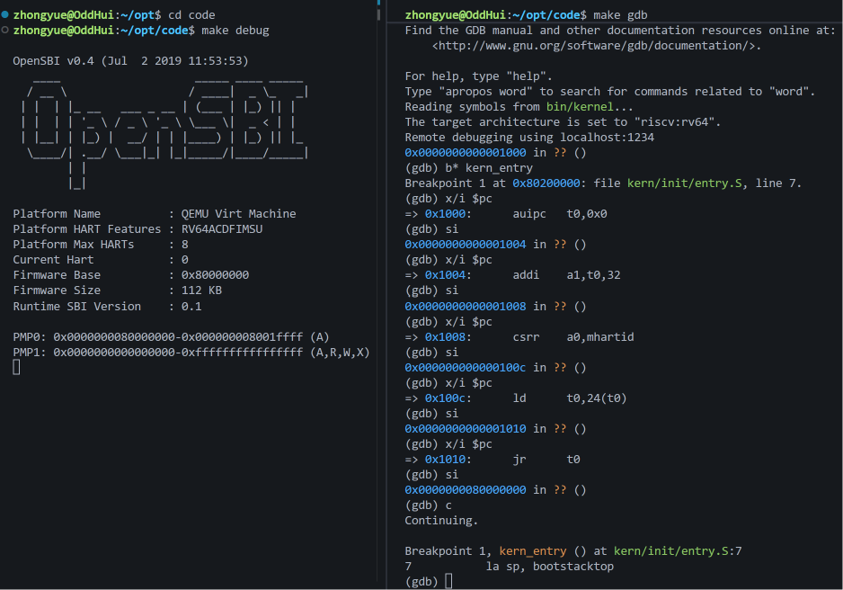

# 操作系统实验报告

## 实验基本信息

| 项目         | 内容                                           |
| ------------ | ---------------------------------------------- |
| **实验名称** | Lab 2: 物理内存和页表                          |
| **小组成员** | 2411858-王钟岳、2412934-王海沛、2412143-林家熠 |
| **完成日期** | 2026-10-21                                     |

### 小组分工

| 成员           | 负责的练习/模块               |
| -------------- | ----------------------------- |
| 2411858-王钟岳 | 功能1及报告                   |
| 2412934-王海沛 | 功能2的任务1、2及报告         |
| 2412143-林家熠 | 功能2的任务3、Challenge及报告 |

---

## 一、实验目的

本实验的主要目的是：

1. 理解页表的建立和使用方法
2. 理解物理内存的管理方法
3. 理解页面分配算法

---

## 二、实验环境

| 成员           | AI 编程工具          | 底层模型    | 备注 |
| -------------- | -------------------- | ----------- | ---- |
| 2411858-王钟岳 | Codex（VS Code插件） | GPT-6 Astra |      |
| 2412934-王海沛 | deepseek             | deepseek    |      |
| 2412143-林家熠 | deepseek             | deepseek    |      |

**说明：**

- **AI 编程工具**：指具体使用的终端工具、编辑器插件、桌面应用或浏览器界面
- **底层模型**：指该工具使用的大语言模型及版本

---

## 三、实验整体逻辑分析

### 2.1 本章节的逻辑主线

本实验以**操作系统的物理内存管理**为核心，具体分成两部分：

1. 如何建立虚拟地址与物理内存的映射关系。
2. 如何实现内存的分配与回收。

在过程中，主要解决了物理内存初始化功能和物理内存分配功能。

### 2.2 功能的逐步实现

1. 首先实现了物理内存的初始化功能（page_init函数）：先知道哪些内存可以进行分配。
2. 再实现了物理内存分配功能：在确定内存可分配范围，建立内存管理结构的基础上，按具体算法选取空闲页，避免误分配已占用的内存。

---

## 四、实验内容与实现

<!--
说明：本部分按照 exercises 文档中的练习顺序组织
每个功能模块或者练习中可能包含多项任务，请根据实际情况调整
-->

### 功能模块：物理内存初始化功能

**负责人：** 2411858-王钟岳

#### 模块功能描述

**需要实现/修改的函数：**

```c
static void page_init(void)
```

**功能说明：**

根据设备树提供的物理内存信息建立可管理物理页的描述符布局，并把排除 OpenSBI、内核镜像和描述符数组占用空间后的完整空闲页面交给当前pmm_manager管理，为后续页面分配提供正确的初始状态。page_init()不接收参数也不返回结果，由pmm_init()调用；成功返回时应正确设置va_pa_offset、npage和pages，输出探测到的物理内存范围，并完成当前物理内存管理器初始空闲区的注册。

#### 最终提示词

以下是经过迭代优化后，最终成功实现该功能的提示词：

```markdown
[PROMPT]
**任务**：修改文件 pmm.c（可以是多个文件），实现或修改 page_init 函数。

**操作要求**：你必须在项目中修改实际文件，而不是仅展示代码。完成函数的实现或修改，包括但不限于：函数主体、辅助函数、内部使用的静态变量等。

**输出要求**：直接进行文件操作。保留文件中的现有代码。实现或修改的代码应插入或更新到相应的位置。第一次实现时，修改到pmm.c的第65行
[RELY]
// 宏定义
框架提供的内存上界、地址转换、页面对齐和页面状态宏
// 数据结构
链接符号end、struct Page及相关全局变量
// 可用函数
get_memory_base()、get_memory_size()、panic()、cprintf()、init_memmap()、pa2page()

[GUARANTEE]
必须实现或修改的接口：

根据设备树提供的物理内存信息建立可管理物理页的描述符布局，并把排除 OpenSBI、内核镜像和描述符数组占用空间后的完整空闲页面交给当前pmm_manager管理，为后续页面分配提供正确的初始状态。

你可以根据需要添加：

- 辅助函数（建议设为static）
- 内部使用的宏定义
- 模块内部的静态变量

[SPECIFICATION]
**Pre-Condition**:

- npage 已有合法值、pages 指针已有值、pages[0..npage-1] 的内容 未初始化、free_list 空链表、nr_free为0

**Post-Condition**:

- pages[i].flags 先全部 reserved=1，再把可用区间清掉 reserved；pages[i].ref 全部清0；pages[i].property 空闲块首块=连续页数，非首块=0；空闲页的 page_link 串进 free_list；nr_free为正数。
  **Case 1**:
  - 区分虚拟地址、物理地址、物理页号和Page描述符地址，正确处理可管理上界和页面对齐，并确保内核及描述符数组不会进入空闲区

  **Case 2**:
  - 设备树信息无效时应终止初始化

  **Case 3**:
  - 没有可用完整页面时不得调用init_memmap()

**Requirements**:

- 中文注释干净简练，减少page_init函数无用的输出。
```

#### 实现迭代过程

本模块的实现经历了 1 次迭代，过程如下：

---

##### 第一次迭代

**最终结果：**

经过 1 次迭代，该模块最终：

- ✅ 编译通过
- ✅ 所有相关测试通过
- ✅ 功能符合预期

---

### Challenge：硬件的可用物理内存范围的获取方法

**负责人：** 2411858-王钟岳

Q：如果 OS 无法提前知道当前硬件的可用物理内存范围，请问你有何办法让 OS 获取可用物理内存范围？

A:需要进行物理内存的探测，以获得可用物理内存范围，这一功能可以由固件或引导程序完成。
以本实验的RISC-V为例，物理内存的探测由OpenSBI完成：

1. OpenSBI 将包括物理内存在内的各外设的扫描结果以 DTB 的格式保存在物理内存中的某个地方，其地址保存在 a1 寄存器中。
2. OS 解析 DTB 的内存节点，获取 RAM 的起始地址和大小。
3. 排除OpenSBI、内核以及Page数组等已被占用的空间，上下取整得到真正可供分配的物理页范围。

---

### 功能模块：物理内存分配功能

**负责人：** 2412934-王海沛、2412143-林家熠

#### 模块功能描述

**需要实现/修改的函数：**

```c
// 列出本模块涉及的所有函数签名
void example_function(void);
int another_function(int arg);
```

**功能说明：**

[简要描述该模块的功能，包括：

- 该模块在整个系统中的作用
- 需要处理的主要场景
- 与其他模块的交互关系]

#### 最终提示词

以下是经过迭代优化后，最终成功实现该功能的提示词：

```markdown
[按照提示词模板，给出具体的提示词]
```

#### 实现迭代过程

本模块的实现经历了 [N] 次迭代，过程如下：

---

##### 第一次迭代

如果设计的prompt生成代码后出现问题：

**遇到的问题：**

- 问题1：问题描述、错误信息和原因分析
- 问题2：问题描述、错误信息和原因分析

**问题解决策略：**

- 针对问题1：[说明如何修改提示词]
- 针对问题2：[说明如何修改提示词]

如果没有问题：

**最终结果：**

经过 [N] 次迭代，该模块最终：

- ✅ 编译通过
- ✅ 所有相关测试通过
- ✅ 功能符合预期

**关键改进点总结（如有）：**

1. [改进点1：例如，在 [RELY] 中补充了完整的系统调用号定义]
2. [改进点2：例如，在 [SPECIFICATION] 中明确了异常处理的边界条件]
3. [改进点3：例如，增加了对用户指针合法性检查的要求]

---

##### 第二次迭代（如有）

[按照和第一次迭代相同的格式]

---

##### 第三次迭代（如有）

[按照和第一次迭代相同的格式]

---

### 练习：任务三：buddy system（伙伴系统）分配算法

**负责人：** 2412143-林家熠

#### 1. 最终提示词

**第一份 Prompt（用于生成 Buddy System 模块并接入内核）：**
```markdown
你是一个操作系统内核开发者。请参考 ucore 的 kern/mm/pmm.h 中的 struct pmm_manager 框架，在 kern/mm/buddy_pmm.c 中实现完整的 Buddy System 物理内存分配模块。

要求：
1. 定义 #define MAX_ORDER 11（最大支持 2^11 个连续页）。
2. 使用 struct Page 的 property 字段记录块的阶数（order），头页的 property 有效。
3. 实现 free_area[MAX_ORDER + 1] 双向链表数组，每个节点挂在对应阶数的空闲块。
4. 实现以下函数：
   - buddy_init：初始化 free_area 链表。
   - buddy_init_memmap：将 [base, base + n) 的空闲页按 2 的幂次拆分，挂入 free_area。
   - buddy_alloc_pages：申请 n 页时向上取整到 2 的 order 次幂，从 free_area[order] 查找，找不到则分裂更大块。
   - buddy_free_pages：释放块并检查伙伴块（通过 PPN 异或计算伙伴页号），如果伙伴空闲则合并。
   - buddy_nr_free_pages：返回 nr_free 总数。
5. 定义 struct pmm_manager buddy_pmm_manager，将函数指针按顺序填入。
6. 在 kern/mm/pmm.c 的 init_pmm_manager 函数中，将 pmm_manager = &buddy_pmm_manager; 以完成接入。
```

**第二份 Prompt（用于生成测试函数）：**

```markdown
请为刚才生成的 Buddy System 分配器编写测试函数 buddy_check()，放在 kern/mm/buddy_pmm.c 中。

测试要求覆盖以下核心行为与边界情况：
1. 基本分配与释放：申请 1 页、2 页、3 页（验证向上取整到 4 页）、8 页，检查返回的页是否合法且不重叠。
2. 伙伴合并：依次释放相邻的伙伴块（如先释放 A，再释放其伙伴 B），验证它们是否被正确合并为更大的块。
3. 边界情况：尝试申请超过 MAX_ORDER 大小的页（如 1 << (MAX_ORDER + 1)），应返回 NULL；释放时传入非对齐的页数应触发 assert 失败。
4. 完整性检查：在测试前后检查 buddy_nr_free_pages() 的总数是否一致。

请输出完整的测试代码，使用 assert 和 cprintf 进行验证和输出。
```

#### 2. 测试覆盖说明与有效性检验

**测试覆盖的核心行为和边界情况：**
- 基本分配与对齐逻辑：通过申请 1、2、3、8 页的内存，验证了 Buddy System 能够正确地将非 2 的幂次大小的请求向上取整到最近的 2 的幂次（例如申请 3 页实际会分配 4 页，验证了向上取整逻辑）。
- 伙伴合并（核心难点）：通过依次释放相邻的伙伴块，测试了算法能否通过物理页号（PPN）的异或操作正确找到伙伴块，并在满足条件时将它们逐层合并成更大的块。
- 边界与鲁棒性：测试了超过 `MAX_ORDER` 的极大内存请求，确保分配器在资源不足或请求非法时能安全地返回 `NULL`，而不是引发系统崩溃；同时验证了释放非对齐页数时会触发断言，保护了内存管理器的内部状态。
- 总数完整性验证：在所有分配和释放操作前后，比对了 `buddy_nr_free_pages()` 返回的空闲页总数，确保没有发生内存泄漏或凭空产生内存。

**为什么能有效检验生成的实现：**

Buddy 算法最核心的两个机制就是分裂（Split）和合并（Merge）。这些测试用例直接针对这两个机制进行验证。例如“申请 3 页”隐式地测试了从更大的空闲块中分裂出所需块的逻辑；“连续释放相邻块”直接验证了伙伴合并逻辑是否正确，如果伙伴异或计算错误，合并将失效，后续申请大块内存就会失败。同时，空闲页总数的严格一致性校验，能有效发现链表操作中的遗漏或死循环。

---

### Challenge：任意大小的内存单元 slub 分配算法

**负责人：** 2412143-林家熠

#### 1. 最终提示词
**第一份 Prompt（用于生成 SLUB 模块并接入内核）：**

```markdown
请帮我实现一个简化的 SLUB 内存分配器。新建 kern/mm/slub.c 和 slub.h。
要求：
1. 底层依赖于现有的页分配器（如 buddy_alloc_pages 或 default_alloc_pages）。
2. 支持分配指定大小的对象（32, 64, 128, 256, 512 字节），向上对齐到 2 的幂次。
3. 内部维护一个 kmem_cache 数组，每种大小对应一个 cache。
4. 当 cache 的空闲链表为空时，调用页分配器申请一页，并将其切分为对应大小的对象挂入空闲链表。
5. 为了在 kfree 时能知道对象大小，请在每个内存块前面添加一个 Header 元数据，记录该块所属的 cache。
6. 提供 kmalloc(size_t size) 和 kfree(void *ptr) 接口。
7. 在 kern/mm/pmm.c 的 pmm_init 末尾调用 slub_init()。
```

**第二份 Prompt（用于生成测试函数）：**

```markdown
请为刚才的 SLUB 分配器编写一个测试函数 slub_check()，放在 slub.c 中，并在 pmm_init 中调用。
测试要求：
1. 基础分配测试：测试分配不同大小（如 32B, 50B, 200B）的对象，并验证返回的指针不为空，且能通过 Header 验证其进入了正确的 Cache 大小。
2. 批量分配测试：连续分配 100 个 128B 的对象，验证是否触发了底层向页分配器申请新页（Refill）。
3. 释放与复用测试：释放刚才分配的所有对象，检查对应 Cache 的空闲对象数是否正确增加。
4. 边界测试：分配大于最大支持范围（如 1024B）和大小为 0 的对象，应返回 NULL。
5. 使用 assert 和 cprintf 输出测试结果。
```

#### 2. 测试覆盖说明与有效性检验

**测试覆盖的核心行为和边界情况：**
- 多尺寸分配与元数据（Header）有效性：测试分配 32B、50B（向上对齐到 64B）、200B（向上对齐到 256B）的对象，不仅验证了不同大小对象的按需分配，还通过检查 Header 中的 `cache` 指针和 `size` 字段，验证了元数据是否被正确写入和读取。
- 按需扩容（Refill）机制：通过一次性申请 100 个 128B 对象，由于一页最多只能切分 32 个 128B 对象（4KB/128B），该测试必然会触发底层页分配器多次分配新页并切分，有效检验了空闲链表耗尽时的自动化扩容能力。
- 释放复用与内存回收：通过 `kfree` 将分配的对象释放后，检查对应 Cache 的 `free_objs` 计数器是否精确增加。这验证了 SLUB 能够正确将内存块挂回空闲链表，为后续复用做好准备。
- 越界安全防御：测试申请 1024B 和 0B 的对象，验证了分配器在遇到非法或超出设计容量的请求时，能安全返回 `NULL`，防止破坏内核堆栈。

**为什么能有效检验生成的 SLUB 实现：**

SLUB 的核心设计是“基于页的两级架构”和“对象复用”。批量分配 100 个对象的测试，最直观地证明了第一层（向底层要整页）和第二层（页内切分）架构的联动是成功的。而 Header 元数据的设计，彻底解决了 `kfree` 传入裸指针时无法获知释放大小的痛点，测试中对 Header 的读取和指针回退操作，证明了该内存管理方案的安全性。此外，通过对比释放前后的空闲对象数，能够精确排查是否存在碎片丢失或链表死锁等严重 Bug。

---

## 五、测试与验证

<!-- 根据该实验的具体情况，提供完整的测试运行截图，应包含：
- 编译及运行成功的输出（make qemu），可能有多个
- 测试通过的结果（make grade），只有一个
-->

**测试截图：**



---

## 六、实验总结与收获

### 对操作系统的理解

1. 列出你们认为本实验中重要的知识点，以及与对应的 OS 原理中的知识点，并简要说明二者的含义、关系和差异
2. 列出你们认为 OS 原理中很重要、但在本实验中没有对应上的知识点

### AI 协作开发的经验

[写出你们在与 AI 协作过程中实际收获的经验或者感悟]

---
