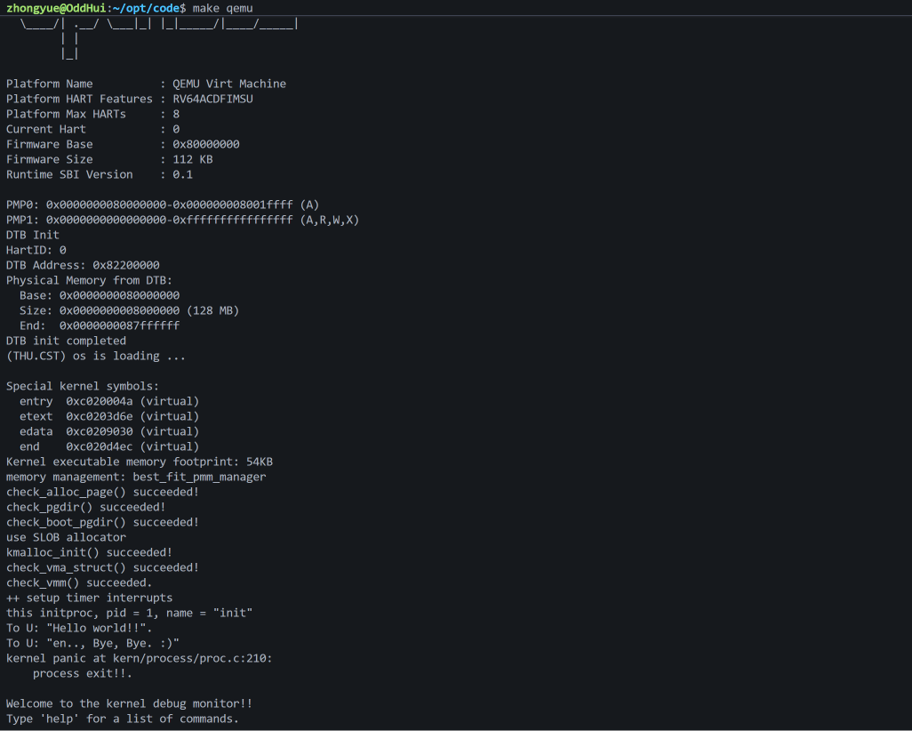
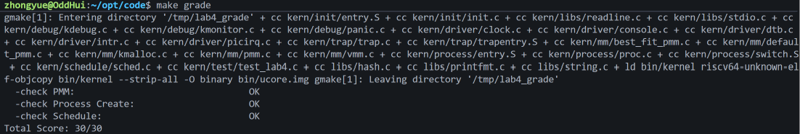

# 操作系统实验报告

## 实验基本信息

| 项目         | 内容                                           |
| ------------ | ---------------------------------------------- |
| **实验名称** | Lab 4: 进程管理                                |
| **小组成员** | 2411858-王钟岳、2412934-王海沛、2412143-林家熠 |
| **完成日期** | 2026-11-19                                     |

### 小组分工

| 成员           | 负责的练习/模块        |
| -------------- | ---------------------- |
| 2411858-王钟岳 | 功能1、Challenge及报告 |
| 2412934-王海沛 | 功能3及报告            |
| 2412143-林家熠 | 功能2及报告            |

---

## 一、实验目的

<!-- 说明本次实验的主要目标和预期成果 -->

本实验的主要目的是：

1. 了解虚拟内存管理的基本结构，掌握虚拟内存的组织与管理方式
2. 了解内核线程创建/执行的管理过程
3. 了解内核线程的切换和基本调度过程

---

## 二、实验环境

你们使用的 AI 工具

| 成员           | AI 编程工具          | 底层模型    | 备注 |
| -------------- | -------------------- | ----------- | ---- |
| 2411858-王钟岳 | Codex（VS Code插件） | GPT-6 Astra |      |
| 2412934-王海沛 | Codex（VS Code插件） | GPT-6.1Sol  |      |
| 2412143-林家熠 | deepseek             | deepseek    |      |

**说明：**

- **AI 编程工具**：指具体使用的终端工具、编辑器插件、桌面应用或浏览器界面
- **底层模型**：指该工具使用的大语言模型及版本

---

## 三、实验整体逻辑分析

### 2.1 本章节的逻辑主线

本章以进程管理为核心主题，详细介绍了虚拟内存管理和内核线程管理两部分，并讲解了页表及页表项设计，idleproc和initproc的设计。最终设计实现了虚拟内存页操作功能、进程创建及初始化功能、进程调度功能，并对部分代码进行了深入思考。

### 2.2 功能的逐步实现

1. 首先实现**虚拟内存页操作功能**：限定软件运行时的访问空间，确保软件运行不越界，实现对内存访问的保护。
2. 接着再完善**进程创建及初始化功能** ：将已能运行的内核代码变成一个线程，并实现内核线程的创建能力。
3. 然后完成**进程调度功能** ：使CPU能够调度已创建的进程。

---

## 四、实验内容与实现

<!--
说明：本部分按照 exercises 文档中的练习顺序组织
每个功能模块或者练习中可能包含多项任务，请根据实际情况调整
-->

### 功能模块：虚拟内存页操作功能

**负责人：** 2411858-王钟岳

#### 模块功能描述

**需要实现/修改的函数：**

```c
int page_insert(pde_t *pgdir, struct Page *page, uintptr_t la, uint32_t perm);
void page_remove(pde_t *pgdir, uintptr_t la);
```

**功能说明：**

这个模块负责在现有多级页表框架上完成最基本的映射维护，也就是把物理页挂到指定线性地址上，以及把已有映射安全地撤销掉。page_insert 负责建立或更新映射，不能简单覆盖旧项，而要正确处理原地址已经映射到同一物理页、或者原地址已经映射到其他物理页这两种情况；page_remove 负责删除映射，映射建立过程本身可能失败，调用路径必须能正确返回错误并保持系统状态干净。所有页表更新完成后都要考虑对应 TLB 失效，否则测试中会出现看似已更新、实际上仍在使用旧翻译结果的情况。

对外只需要提供“建立映射”和“撤销映射”两个动作。page_insert 成功时应让指定线性地址稳定映射到目标物理页，并把权限位设置为调用者要求的状态；失败时应返回 -E_NO_MEM，且不能留下半完成映射。

#### 最终提示词

以下是经过迭代优化后，最终成功实现该功能的提示词：

```markdown
[PROMPT]

**任务**：修改文件 mm/pmm.c，实现 page_insert、page_remove 函数。

**操作要求**：你必须在项目中修改实际文件，而不是仅展示代码。完成函数的实现或修改，包括但不限于：函数主体、辅助函数、内部使用的静态变量等。

**输出要求**：直接进行文件操作。不要修改文件中的现有代码。实现或修改的代码应插入或更新到相应的位置（224行）。

[RELY]

这个模块主要依赖 get_pte()、pte_create()、pte2page()、page_ref_inc()、page_ref_dec()、set_page_ref()、alloc_page()、free_page()、tlb_invalidate()、flush_tlb() 等现成接口，也依赖 pde_t、pte_t、struct Page、pages、boot_pgdir_va 以及页表权限位宏 PTE_V、PTE_U、PTE_W、PTE_R。其中 get_pte() 负责定位目标页表项，后续两个函数则在此基础上完成映射建立和映射删除。

[GUARANTEE]

必须实现或修改的接口：
对外只需要提供“建立映射”和“撤销映射”两个动作。

你可以根据需要添加：

- 辅助函数（建议设为static）
- 内部使用的宏定义
- 模块内部的静态变量

[SPECIFICATION]

整个功能模块的具体功能为：这个模块负责在现有多级页表框架上完成最基本的映射维护，也就是把物理页挂到指定线性地址上，以及把已有映射安全地撤销掉。page_insert 负责建立或更新映射，page_remove 负责删除映射，它们共同决定一个线性地址最终对应哪一页物理内存，同时也决定物理页引用计数是否正确、页表状态是否一致、TLB 是否需要失效。这个模块完成后，页表测试、静态内核映射检查以及后续线程地址空间相关逻辑才有可靠基础。

**Case 1**:
page_insert 成功时应让指定线性地址稳定映射到目标物理页，并把权限位设置为调用者要求的状态

**Case 2**:
page_insert 失败时应返回 -E_NO_MEM，且不能留下半完成映射。

**Case 3**:
page_remove 则应作为一个幂等删除接口存在，目标地址有映射时删除映射、无映射时安静返回，不应把“未映射地址”当作异常情况。

**Requirements**:

这里最关键的是保持“页表项内容、物理页引用计数、TLB 状态”三者同步。page_insert 不能简单覆盖旧项，而要正确处理原地址已经映射到同一物理页、或者原地址已经映射到其他物理页这两种情况；page_remove 也不能假定目标地址一定存在有效映射。由于 get_pte(pgdir, la, 1) 可能需要分配中间级页表页，所以映射建立过程本身可能失败，调用路径必须能正确返回错误并保持系统状态干净。所有页表更新完成后都要考虑对应 TLB 失效，否则测试中会出现看似已更新、实际上仍在使用旧翻译结果的情况。
```

#### 实现迭代过程

本模块的实现经历了 2 次迭代，过程如下：

---

##### 第一次迭代

**遇到的问题：**

- 问题1：额外修改了函数 get_pte()。

**问题解决策略：**

- 针对问题1：要求禁止修改原有代码。

**最终结果：**

对 get_pte() 进行了额外的修改。

---

##### 第二次迭代

**最终结果：**

经过 2 次迭代，该模块最终：

- ✅ 编译通过
- ✅ 所有相关测试通过
- ✅ 功能符合预期

**关键改进点总结：**

在 [PROMPT] 中要求禁止修改原有代码。

---

### 功能模块：进程创建及初始化功能

参见实验报告模板

---

### 功能模块：进程调度
**负责人：** 2412934-王海沛

#### 模块功能描述
**需要实现/修改的函数：**

```c
void cpu_idle(void);                              // kern/process/proc.c
void schedule(void);                              // kern/schedule/sched.c
void proc_run(struct proc_struct *proc);            // kern/process/proc.c
void switch_to(struct context *from,
               struct context *to);                // kern/process/switch.S
```

**功能说明：**

本模块负责将已经创建的内核线程交给 CPU 执行，完成从调度请求、线程选择到上下文切换的完整过程。

cpu_idle() 作为空闲线程的执行主体，持续检查当前线程的 need_resched 标志，并在需要重新调度时调用 schedule()。schedule() 遍历进程链表，选择处于 PROC_RUNNABLE 状态的线程，在没有可运行线程时选择 idleproc。

proc_run() 在关闭中断的临界区内更新 current，设置目标线程的 Sv39 页表，刷新 TLB，并调用 switch_to() 完成上下文切换。switch_to()根据 struct context 的布局保存旧线程的 ra、sp和 s0～s11，恢复目标线程的对应寄存器。

新线程首次执行时，通过预先设置的 context.ra 进入 forkret，随后沿 forkrets → __trapret 恢复链路进入内核线程入口。

#### 最终提示词

以下是经过迭代优化后，最终成功实现该功能的提示词：

```markdown
[PROMPT]

任务

修改项目中的实际文件，实现进程调度模块的四个接口。
void cpu_idle(void);
void schedule(void);
void proc_run(struct proc_struct *proc);
void switch_to(struct context *from, struct context *to);
操作要求

直接修改项目文件，在对应占位位置补充实现。禁止修改已有函数的实现逻辑，保留已有线程创建、中断处理和内存管理代码。遇到影响编译的已有问题时，应明确记录原因。

输出要求

完成实际文件修改，并说明实现逻辑、编译验证结果以及尚未完成的运行验证。

[RELY]

本模块主要依赖以下接口和数据结构。
- 进程结构与上下文结构，包括 struct proc_struct、`struct context`。
- 调度相关对象，包括 proc_list、`current`、`idleproc`。
- 线程状态与统计字段，包括 PROC_RUNNABLE、`need_resched`、`runs`。
- 临界区保护接口，包括 local_intr_save()、`local_intr_restore()`。
- 链表访问接口，包括 list_next()、`le2proc()`。
- 页表切换接口与常量，包括 write_csr()、`SATP_MODE_SV39`、`RISCV_PGSHIFT`、`flush_tlb()`。
- 首次运行恢复链路，包括 forkret、`forkrets`、`__trapret`。
libs/riscv.h 中的 lsatp() 使用 Sv32 格式，本实验应参照 enable_paging() 的写法构造 Sv39 satp。

[GUARANTEE]

必须实现以下对外行为。
- cpu_idle() 持续执行空闲循环，在需要重新调度时调用 schedule()。
- schedule() 完成一次合法的调度选择，更新运行次数，并在需要时切换线程。
- proc_run() 更新当前线程、切换页表并执行上下文切换。
- switch_to() 按照两个上下文指针完成寄存器保存与恢复。

[SPECIFICATION]

Case 1
当 idleproc->need_resched 被置位且 initproc 处于可运行状态时，空闲线程应触发调度，使 initproc 获得 CPU。
Case 2
从当前线程之后开始循环遍历进程链表，选择遇到的可运行线程。遍历过程中应跳过链表头节点。
Case 3
找不到可运行线程时，选择 idleproc。目标线程与当前线程相同时，应避免重复切换上下文。
Case 4
proc_run() 应在关闭中断的临界区内完成 current 更新、Sv39 satp 写入、TLB 刷新和上下文切换，并在恢复执行后恢复进入临界区之前的中断状态。
Case 5
switch_to() 应使用 RV64 的寄存器宽度和结构体偏移，保存与恢复 ra、`sp`、`s0`～`s11`。

Requirements

调度选择与线程切换过程中，应保持当前线程指针、页表和寄存器上下文一致。`switch_to()` 只负责上下文保存和恢复，调度策略由 schedule() 完成。首次运行的线程应能够利用前一模块构造的上下文和中断帧进入正确入口。
```

#### 实现迭代过程

本模块的实现经历了 1 次迭代，过程如下：

---

##### 第一次迭代


**最终结果：**

经过1次迭代，该模块最终：

- ✅ 编译通过
- ✅ 所有相关测试通过
- ✅ 功能符合预期

**关键改进点总结：**

按照 struct context 的实际布局实现汇编偏移。

正确使用 Sv39 格式构造 satp。

通过保存和恢复中断状态保护调度与切换过程。

---


---

### Challenge：

**负责人：** 2411858-王钟岳

Q1：说明语句 local_intr_save(intr_flag); ... local_intr_restore(intr_flag); 是如何实现开关中断的。

A：两个宏通过控制 sstatus 寄存器中的 SIE 位实现开关中断。具体来说，local_intr_save(intr_flag) 保存 SIE 位并置 0，执行临界区代码，随后 local_intr_restore(intr_flag) 根据保存在 intr_flag 中的结果恢复 SIE 位。

Q2：get_pte() 函数中有两段形式类似的代码，结合 sv32、sv39、sv48 的异同，解释这两段代码为什么如此相像。

A：两段相似的代码分别是：

```c
pde_t *pdep1 = &pgdir[PDX1(la)];
if (!(*pdep1 & PTE_V)) {
    // 分配页表页、设置引用计数、清零，并写入 pdep1
}
```

```c
pde_t *pdep0 =
    &((pte_t *)KADDR(PDE_ADDR(*pdep1)))[PDX0(la)];
if (!(*pdep0 & PTE_V)) {
    // 分配页表页、设置引用计数、清零，并写入 pdep0
}
```

第一段代码的功能是通过 PDX1(la) 找到根页表中的表项，检查并按需创建下一级页表；第二段代码根据上一表项找到中间页表，再用 PDX0(la) 定位，检查并按需创建下一级页表。

两段相似是因为：Sv32、SV39、Sv48都是多级页表，页表各层结构相似，向下走一级所做的操作也相同。按照这种展开写法，Sv32 只需一段“定位或创建下一级页表”的逻辑，Sv39 需要两段，Sv48 则需要三段。

Q3：目前 get_pte() 函数将页表项查找和页表页分配合并在一个函数里，你认为这种写法好吗？有没有必要把两个功能拆开？

A：这样的写法是合理的，但在复杂系统下可能会产生问题。当前 get_pte() 通过参数 create 的值区分查找和分配两种行为。这样写的好处在于需要分配时能复用页表查找的逻辑进行遍历；但缺点是返回 NULL 既可能表示页表不存在也可能表示分配失败，且分配失败没有进行回滚。

---

## 五、测试与验证

<!-- 根据该实验的具体情况，提供完整的测试运行截图，应包含：
- 编译及运行成功的输出（make qemu），可能有多个
- 测试通过的结果（make grade），只有一个
-->

测试之前，补全了 lab2 和 lab3 的缺失代码，并将之前实验的 best_fit_pmm.c 和 best_fit_pmm.h 复制到当前实验里，将 pmm.c 中的 pmm_manager 设为定义的 best_fit_pmm_manager。同时在 memlayout.h 中补充了 page_init() 函数依赖的两个宏。

在 code 目录下运行 make qemu 和 make grade，结果如下：

**测试截图：**




---

## 六、实验总结与收获

### 对操作系统的理解

1. 列出你们认为本实验中重要的知识点，以及与对应的 OS 原理中的知识点，并简要说明二者的含义、关系和差异

（1）进程状态与调度选择
- 实验中的知识点
  schedule() 遍历进程链表，通过 PROC_RUNNABLE 状态判断线程是否可以获得 CPU。
- 对应的 OS 原理
  操作系统通过进程状态描述执行情况，调度器从就绪进程中选择下一个执行者。
- 联系与差异
  本实验使用 PROC_RUNNABLE 同时表示就绪和正在运行，通过 current 区分当前运行线程。OS 原理通常分别讨论就绪态和运行态。

（2）循环调度与 CPU 调度策略
- 实验中的知识点
  schedule() 从当前线程之后开始循环遍历链表，选择遇到的可运行线程。没有可运行线程时选择 idleproc。
- 对应的 OS 原理
  CPU 调度策略决定就绪进程获得 CPU 的顺序，影响公平性、响应时间和吞吐量。
- 联系与差异
  本实验实现了简单的循环选择机制。完整的时间片轮转调度还需要定时器触发抢占，其他调度算法则可能考虑优先级等因素。

（3）重调度标志与调度时机
- 实验中的知识点
  cpu_idle() 持续检查 need_resched，标志置位时调用 schedule()。
- 对应的 OS 原理
  调度请求可以先通过标志记录，再在适当的执行位置进行调度。
- 联系与差异
  本实验首次调度由初始化时设置的重调度标志触发。目前时钟中断尚未接入时间片抢占路径。

（4）寄存器保存与上下文切换
- 实验中的知识点
  switch_to() 保存旧线程的 ra、`sp`、`s0`～`s11`，并恢复目标线程的对应寄存器。
- 对应的 OS 原理
  上下文切换通过保存和恢复执行现场，使多个进程或线程能够交替使用 CPU。
- 联系与差异
  本实验根据 RISC-V 调用约定保存被调用者保存寄存器，并保存返回地址和栈指针。中断现场中的其他寄存器由中断帧恢复路径管理。

（5）临界区保护与原子性
- 实验中的知识点
  schedule() 和 proc_run() 使用 local_intr_save()、`local_intr_restore()` 保护关键操作。
- 对应的 OS 原理
  临界区保护用于避免共享状态在更新过程中受到并发执行的干扰。
- 联系与差异
  本实验通过关闭本地中断，避免单核上的中断打断调度与切换过程。多核系统还需要锁等同步机制协调其他 CPU 的访问。

（6）页表切换与地址空间
- 实验中的知识点
  proc_run() 将目标线程的页表物理地址写入 Sv39 格式的 satp，随后刷新 TLB。
- 对应的 OS 原理
  页表决定虚拟地址到物理地址的映射，TLB 缓存地址翻译结果。切换地址空间时需要维护二者的一致性。
- 联系与差异
  本实验中的内核线程共享内核地址空间。用户进程通常拥有独立地址空间，切换时需要使用各自的页表。

（7）首次运行与执行环境初始化
- 实验中的知识点
  新线程通过预先设置的 context.ra 进入 forkret，再沿 forkrets → __trapret 恢复中断帧，进入线程入口。
- 对应的 OS 原理
  新进程或线程需要在第一次获得 CPU 前建立初始执行环境，包括入口地址、栈和处理器状态。
- 联系与差异
  首次运行依赖人工构造的上下文和中断帧。后续再次运行时，则恢复线程此前暂停时保存的上下文。

2. 列出你们认为 OS 原理中很重要、但在本实验中没有对应上的知识点

多核调度、负载均衡和 CPU 亲和性。

线程阻塞、唤醒以及同步等待队列。

用户进程的独立地址空间和用户态、内核态切换。

### AI 协作开发的经验

通过本次协作，我们认识到，提示词需要明确函数接口、依赖条件、修改范围和验收标准。例如，明确要求使用 Sv39 satp，可以避免误用项目中遗留的 Sv32 接口。

AI 生成的底层代码需要结合结构体布局、调用约定和硬件执行流程检查。汇编中的寄存器偏移、临界区的中断状态恢复以及新线程首次运行的返回地址，都直接影响系统能否正确执行。

验证结果也需要准确记录。本次修改文件已经通过交叉编译，但完整构建和 QEMU 运行验证仍有待完成，因此报告只能确认已实现与已验证的部分。

在限制修改范围时，可以在 [PROMPT] 中要求“禁止修改已有函数实现”，同时明确是否允许补充前置声明。这样能够减少 AI 对其他模块的额外修改，并让最终改动更容易审核。

---
