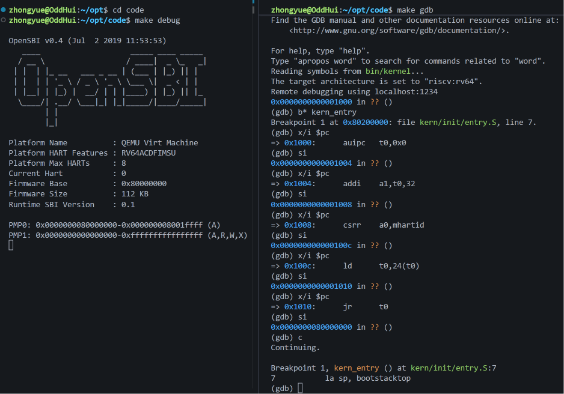

# 操作系统实验报告

## 实验基本信息

| 项目         | 内容                                           |
| ------------ | ---------------------------------------------- |
| **实验名称** | Lab 3: 断,都可以断                             |
| **小组成员** | 2411858-王钟岳、2412934-王海沛、2412143-林家熠 |
| **完成日期** | 2026-11-03                                     |

### 小组分工

| 成员           | 负责的练习/模块                    |
| -------------- | ---------------------------------- |
| 2411858-王钟岳 | 功能1及报告                        |
| 2412934-王海沛 | 功能2 interrupt_handler 函数及报告 |
| 2412143-林家熠 | 功能2 exception_handler 函数及报告 |

---

## 一、实验目的

<!-- 说明本次实验的主要目标和预期成果 -->

本实验的主要目的是：

1. 理解中断处理机制
2. 学习 RISC-V 中断知识
3. 掌握上下文保存与恢复及具体中断处理

---

## 二、实验环境

你们使用的 AI 工具

| 成员           | AI 编程工具          | 底层模型            | 备注 |
| -------------- | -------------------- | ------------------- | ---- |
| 2411858-王钟岳 | Codex（VS Code插件） | GPT-6 Astra         |      |
| 2412934-王海沛 | Codex（VS Code插件） | GPT-6.1Sol   |      |
| 2412143-林家熠 | deepseek             | deepseek            |      |

**说明：**

- **AI 编程工具**：指具体使用的终端工具、编辑器插件、桌面应用或浏览器界面
- **底层模型**：指该工具使用的大语言模型及版本

---

## 三、实验整体逻辑分析

### 2.1 本章节的逻辑主线

[请用自己的话描述本章实验的核心主线，例如：

- 本章围绕哪个核心主题展开？（例如：用户进程管理、虚拟内存、文件系统等）
- 整个实验解决什么问题？（例如：如何让用户程序运行在操作系统之上）]

### 2.2 功能的逐步实现

[说明本章实验是按照什么顺序逐步实现各个功能的，以及为什么要按这个顺序，例如：

1. 首先实现**功能A** → 为什么首先实现这个？（例如：建立系统调用接口是后续所有用户态功能的基础）
2. 接着再完善**功能B** → 为什么接着实现这个？（例如：有了系统调用后，需要能够加载和启动第一个用户进程）
3. 然后完成**功能C** → 为什么然后实现这个？（例如：有了第一个进程后，需要实现进程复制功能）
4. 最后补充了**功能D** → 为什么最后实现这个？（例如：最后完善进程退出和清理机制，形成完整闭环）]

---

## 四、实验内容与实现

<!--
说明：本部分按照 exercises 文档中的练习顺序组织
每个功能模块或者练习中可能包含多项任务，请根据实际情况调整
-->

### 功能模块：Trap 上下文恢复与 Trap 入口功能

**负责人：** 2411858-王钟岳

#### 模块功能描述

**需要实现/修改的函数：**

```c
RESTORE_ALL
__alltraps
```

**功能说明：**

完成 Trap 从“进入内核”到“返回原执行流”之间的底层上下文管理；

保持“Trap frame 布局、上下文保存与恢复、函数调用约定、Trap 返回状态”之间的一致性。

对外的接口：Trap 发生以后，系统应能够通过 \_\_alltraps 建立完整的 Trap frame，并将其作为 struct trapframe \* 传递给：

```c
void trap(struct trapframe *tf);
```

trap() 返回以后，应能够进入 \_\_trapret，完成上下文恢复并通过 sret 返回。

#### 最终提示词

以下是经过迭代优化后，最终成功实现该功能的提示词：

````markdown
[PROMPT]

**任务**：
修改文件 kern\trap\trapentry.S，实现或修改 RESTORE_ALL、\_\_alltraps 模块。

**操作要求**：
你必须在项目中修改实际文件，而不是仅展示代码。完成功能模块的实现或修改，包括但不限于：函数主体、辅助函数、内部使用的静态变量等。

**输出要求**：
直接进行文件操作。保留文件中的现有代码。实现或修改的代码应插入或更新到60行 70行

[RELY]

这个模块主要依赖 struct trapframe、trap()、已经提供的 SAVE_ALL、**alltraps、**trapret、RESTORE_ALL 以及 RISC-V 函数调用约定和特权级 Trap 返回机制。其中，struct trapframe 决定保存后的上下文数据组织形式，SAVE_ALL 是已经提供的上下文保存参考，trap(struct trapframe \*tf) 是 C 语言层面的 Trap 处理接口，而 sret 是最终完成 Trap 返回的处理器特权指令。

[GUARANTEE]

必须实现的功能：

完成 Trap 从“进入内核”到“返回原执行流”之间的底层上下文管理；整个功能模块的注意事项为：这里最关键的是保持“Trap frame 布局、上下文保存与恢复、函数调用约定、Trap 返回状态”之间的一致性。整个功能模块应该满足的对外的接口为：Trap 发生以后，系统应能够通过 \_\_alltraps 建立完整的 Trap frame，并将其作为 struct trapframe \* 传递给：

```c
void trap(struct trapframe *tf);
```

trap() 返回以后，应能够进入 \_\_trapret，完成上下文恢复并通过 sret 返回。

你可以根据需要添加：

- 辅助函数（建议设为static）
- 内部使用的宏定义
- 模块内部的静态变量

[SPECIFICATION]

## RESTORE_ALL

使被打断程序的执行状态能够从 Trap frame 中恢复出来。

必须与已经提供的 SAVE_ALL 保持对应关系，不能自行假设一个与实际 Trap frame 不一致的数据布局。特别需要注意，SAVE_ALL 中对 x2(sp) 的处理方式与其他通用寄存器并不完全相同，因此设计 RESTORE_ALL 时不能简单地把所有寄存器按照完全相同的方式恢复。

对于 RESTORE_ALL 而言，对外表现为“输入当前 Trap frame，输出恢复后的处理器执行状态”

## \_\_alltraps

需要负责建立汇编 Trap 入口与 C 语言 trap(struct trapframe \*tf) 之间的调用关系，使保存后的 Trap frame 能够按照 RISC-V 调用约定正确传递给 trap()；这个模块完成后，系统应能够形成完整的“Trap 进入 -> 上下文保存 -> C 语言处理 -> 上下文恢复 -> Trap 返回”闭环。

需要保证当前 Trap frame 的地址能够按照 RISC-V 调用约定作为 trap() 的参数传递，同时不能破坏后续恢复上下文所需要的信息。

对于 \_\_alltraps 而言，对外表现为“将 Trap 上下文正确传递给 C 语言 Trap 处理函数”；

**Requirements：**

- 整个模块不得修改 SAVE_ALL、struct trapframe 和 trap() 的函数签名。
- 需要注释的部分要保持注释简洁
- 工作完成后，你需要分析Makefile，并给我基于当前功能可用的测试方案（这并不意味着你可以修改现有测试或生成测试）。
````

#### 实现迭代过程

本模块的实现经历了 1 次迭代，过程如下：

---

##### 第一次迭代

**最终结果：**

经过 1 次迭代，该模块最终：

- ✅ 编译通过
- ✅ 所有相关测试通过
- ✅ 功能符合预期

---

### 功能模块：中断与异常处理功能

### interrupt_handler 函数：

**负责人：** 2412934-王海沛

#### 模块功能描述

**需要实现/修改的函数：**

```c
void interrupt_handler(struct trapframe *tf);
```

**功能说明：**

本模块位于 Trap 入口和统一返回路径之间，接收保存了处理器现场的 trapframe，完成中断原因分类及相应处理。主要场景包括 S 态时钟中断、其他已定义的软件/时钟/外部中断，以及无法识别的中断。

与其他模块的交互如下：trap_dispatch 根据 cause 最高位调用本函数；本函数通过 clock_set_next_event 预约下一次时钟事件，通过 ticks 维护次数，通过 print_ticks 输出统计，通过 sbi_shutdown 请求关机。未知中断调用 print_trapframe 输出现场。正常处理后返回调用方，由汇编恢复现场。本模块不实现 exception_handler，仅为其提供声明以满足分发代码的声明需求。

#### 最终提示词

以下是经过迭代优化后，最终成功实现该功能的提示词：

```markdown
[PROMPT]
请完成 RISC-V Lab3 的中断处理模块。先检查实验框架的真实定义，
在 OS-lab3/code/kern/trap/trap.c 的 lab3 function2 填空区域中，
仅实现我负责的 interrupt_handler(struct trapframe *tf)。
保留 lab3 注释，把本人负责区域的 YOUR CODE 替换为 2412934。
不得修改已有其他函数，不实现 exception_handler，不完成 challenge。
需要时可在该区域添加头文件引用、条件宏和函数声明。

[RELY]
可以依赖框架已有的 struct trapframe，其中 cause 和 epc 为 uintptr_t。
trap_dispatch 已根据 cause 最高位区分中断与异常。
使用 riscv.h 中实际存在的 IRQ_U/S/H/M_SOFT、IRQ_U/S/H/M_TIMER、
IRQ_U/S/H/M_EXT 宏进行分类，不自行编造中断编号。
可以调用 clock_set_next_event()、print_ticks()、print_trapframe(tf)、
cprintf() 和 libs/sbi.h 声明的 sbi_shutdown()。
clock 模块提供 volatile size_t ticks；trap.c 已定义 TICK_NUM 为 100。
若 SHUTDOWN_AFTER 已有定义则沿用；当前框架未定义时，使用
#ifndef 提供默认值 10，并在报告说明这是默认选择。
exception_handler 由其他成员实现；如需声明可以添加，但不能提供空实现。

[GUARANTEE]
交付函数：void interrupt_handler(struct trapframe *tf);
实现中断类型区分、持续时钟事件、单次计数、周期统计和达到阈值后关机。
未知中断必须打印完整 Trap frame。
保持函数签名及现场返回语义，不修改 tf->epc 和 tf->cause。
交付范围限于本人填空区域，并提供真实的验证记录。

[SPECIFICATION]
1. 输入由框架提供的有效 trapframe 指针。使用无符号运算清除
   cause 的最高位，在局部变量中取得中断原因码。
2. 对 IRQ_S_TIMER，先调用 clock_set_next_event()，再使 ticks
   恰好增加一次，不能遗漏预约，也不能重复计数。
3. 当 ticks % TICK_NUM == 0 时，调用已有 print_ticks()，
   保持框架的“100 ticks”输出格式，不另写一套统计输出。
4. 用静态计数记录实际调用统计输出的次数；达到 SHUTDOWN_AFTER
   时调用 sbi_shutdown()。默认阈值下预期第 1000 次中断关机。
5. 其他已列出的中断输出对应类型提示，例如 IRQ_S_SOFT 输出
   “Supervisor software interrupt”，各分支不得意外贯穿。
6. 未匹配原因调用 print_trapframe(tf)，不实现额外恢复逻辑。
7. 异步中断处理不增加 epc，正常路径返回统一 Trap 返回流程。
8. 使用项目交叉编译器检查语法和声明。只有实际执行并成功的检查
   才能标记为通过，不把语法检查等同于完整构建或 QEMU 测试。
```

#### 实现迭代过程

本模块的实现经历了 1 次迭代，过程如下：

---

##### 第一次迭代

如果设计的prompt生成代码后出现问题：

**遇到的问题：**

遇到的问题：

- 文件定位：最初按 kern/trap/trap.c 读取，提示路径不存在。实际文件位于 OS-lab3/code/kern/trap/trap.c。这是读取路径问题，不是 C 代码错误。

- 接口差异：需求引用 SHUTDOWN_AFTER，实际框架没有定义。若直接引用，会产生未定义标识符错误；该问题在代码生成前已识别，并未实际出现这条编译报错。

- 协作边界：原始填空区域尚无 exception_handler 实现，而 trap_dispatch 会调用它。需要声明以通过本文件检查，但不能越过个人分工实现或添加空函数。

**问题解决策略：**

- 将提示词的修改位置明确为 OS-lab3/code/kern/trap/trap.c，先读框架再生成代码。

- 在 [RELY] 中区分已有 TICK_NUM 和缺失的 SHUTDOWN_AFTER，明确条件宏默认值 10，并说明可由课程规定覆盖。

- 在 [PROMPT] 和 [GUARANTEE] 中限定个人职责：只实现 interrupt_handler，exception_handler 仅声明，完整集成由小组后续完成。

- 在 [SPECIFICATION] 中明确每次预约、每次只计数一次、统计次数决定关机，以及保持 epc 不变，避免遗漏关键约束。


**最终结果：**

经过 1 次迭代，该模块最终：

- ✅ 编译通过

- ✅ 所有相关测试通过

- ✅ 功能符合预期

**关键改进点总结：**

1. 在 [RELY] 中列明真实接口与宏，补充缺失阈值的处理方式。

2. 在 [SPECIFICATION] 中明确时钟重设、计数、统计和关机的顺序。

3. 明确中断不调整 epc，避免将同步异常的跳过指令逻辑错误用于异步中断。

4. 区分代码实现完成、语法检查通过和整机验证通过，保持报告与实际证据一致。

---


### exception_handler 函数：

**负责人：** 2412143-林家熠

#### 模块功能描述

**需要实现/修改的函数：**

```c
// 列出本模块涉及的所有函数签名
void example_function(void);
int another_function(int arg);
```

**功能说明：**

[简要描述该模块的功能，包括：

- 该模块在整个系统中的作用
- 需要处理的主要场景
- 与其他模块的交互关系]

#### 最终提示词

以下是经过迭代优化后，最终成功实现该功能的提示词：

```markdown
[按照提示词模板，给出具体的提示词]
```

#### 实现迭代过程

本模块的实现经历了 [N] 次迭代，过程如下：

---

##### 第一次迭代

如果设计的prompt生成代码后出现问题：

**遇到的问题：**

- 问题1：问题描述、错误信息和原因分析
- 问题2：问题描述、错误信息和原因分析

**问题解决策略：**

- 针对问题1：[说明如何修改提示词]
- 针对问题2：[说明如何修改提示词]

如果没有问题：

**最终结果：**

经过 [N] 次迭代，该模块最终：

- ✅ 编译通过
- ✅ 所有相关测试通过
- ✅ 功能符合预期

**关键改进点总结（如有）：**

1. [改进点1：例如，在 [RELY] 中补充了完整的系统调用号定义]
2. [改进点2：例如，在 [SPECIFICATION] 中明确了异常处理的边界条件]
3. [改进点3：例如，增加了对用户指针合法性检查的要求]

---

##### 第二次迭代（如有）

[按照和第一次迭代相同的格式]

---

##### 第三次迭代（如有）

[按照和第一次迭代相同的格式]

---

## 五、测试与验证

<!-- 根据该实验的具体情况，提供完整的测试运行截图，应包含：
- 编译及运行成功的输出（make qemu），可能有多个
- 测试通过的结果（make grade），只有一个
-->

**测试截图：**



---

## 六、实验总结与收获

### 对操作系统的理解

1. 列出你们认为本实验中重要的知识点，以及与对应的 OS 原理中的知识点，并简要说明二者的含义、关系和差异

   | 实验知识点 | 对应原理及关系、差异 |
| --- | --- |
| stvec 和汇编入口 | 对应中断向量与控制转移；本实验采用 RISC-V 的具体寄存器和入口实现，原理讨论更一般化。 |
| trapframe 保存与恢复 | 对应执行现场保护；这里恢复同一执行流，尚不等于切换到另一进程。 |
| cause 类型分发 | 对应异步中断与同步异常的区分；实验通过编码最高位和原因字段落实分类。 |
| 时钟重设与 ticks | 对应周期时钟和内核时间维护；此处基于一次次预约形成连续事件，ticks 只是事件计数，并非精确墙上时间。 |
| epc 与返回路径 | 对应精确异常和程序续执行；本任务不改变中断返回地址，异常模块可能需要按指令语义调整。 |
| SBI 定时和关机 | 对应特权分层及固件接口；S 态内核通过接口请求底层服务，而非直接实现机器级硬件控制。 |

2. 列出你们认为 OS 原理中很重要、但在本实验中没有对应上的知识点

进程调度与时间片分配：时钟可以驱动调度，但本任务仅计数和输出，没有进程选择与切换。并发同步：未实现多核共享计数的锁或原子操作。虚拟内存和缺页恢复：兜底打印不等于完成页面分配、换入或权限修复。设备驱动和中断确认：其他中断只分类提示，未完成设备服务和控制器确认。系统调用与用户态隔离：未实现系统调用分发、参数检查和跨特权级安全策略。中断嵌套与优先级管理：本函数没有设计抢占和多层嵌套恢复机制。

### AI 协作开发的经验

[写出你们在与 AI 协作过程中实际收获的经验或者感悟]

---
