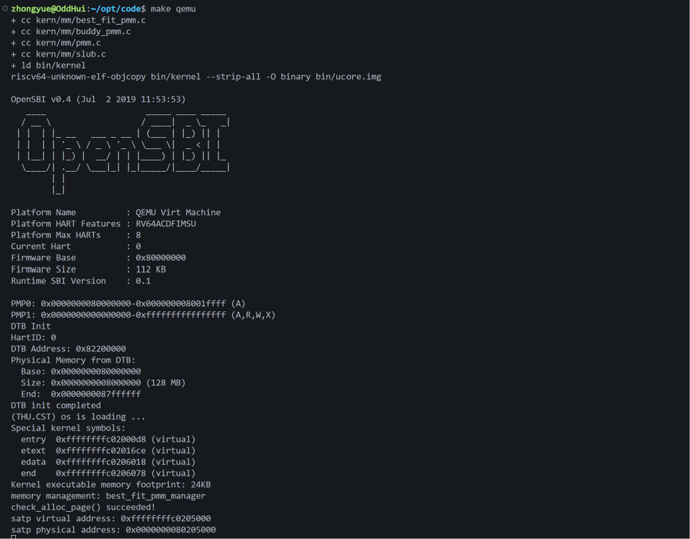
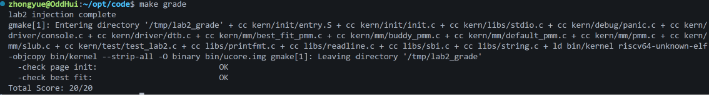

# 操作系统实验报告

## 实验基本信息

| 项目         | 内容                                           |
| ------------ | ---------------------------------------------- |
| **实验名称** | Lab 2: 物理内存和页表                          |
| **小组成员** | 2411858-王钟岳、2412934-王海沛、2412143-林家熠 |
| **完成日期** | 2026-10-21                                     |

### 小组分工

| 成员           | 负责的练习/模块               |
| -------------- | ----------------------------- |
| 2411858-王钟岳 | 功能1及报告                   |
| 2412934-王海沛 | 功能2的任务1、2及报告         |
| 2412143-林家熠 | 功能2的任务3、Challenge及报告 |

---

## 一、实验目的

本实验的主要目的是：

1. 理解页表的建立和使用方法
2. 理解物理内存的管理方法
3. 理解页面分配算法

---

## 二、实验环境

| 成员           | AI 编程工具          | 底层模型            | 备注 |
| -------------- | -------------------- | ------------------- | ---- |
| 2411858-王钟岳 | Codex（VS Code插件） | GPT-6 Astra         |      |
| 2412934-王海沛 | deepseek             | deepseek-V4.1-Flash |      |
| 2412143-林家熠 | deepseek             | deepseek            |      |

**说明：**

- **AI 编程工具**：指具体使用的终端工具、编辑器插件、桌面应用或浏览器界面
- **底层模型**：指该工具使用的大语言模型及版本

---

## 三、实验整体逻辑分析

### 2.1 本章节的逻辑主线

本实验以**操作系统的物理内存管理**为核心，具体分成两部分：

1. 如何建立虚拟地址与物理内存的映射关系。
2. 如何实现内存的分配与回收。

在过程中，主要解决了物理内存初始化功能和物理内存分配功能。

### 2.2 功能的逐步实现

1. 首先实现了物理内存的初始化功能（page_init函数）：先知道哪些内存可以进行分配。
2. 再实现了物理内存分配功能：在确定内存可分配范围，建立内存管理结构的基础上，按具体算法选取空闲页，避免误分配已占用的内存。

---

## 四、实验内容与实现

<!--
说明：本部分按照 exercises 文档中的练习顺序组织
每个功能模块或者练习中可能包含多项任务，请根据实际情况调整
-->

### 功能模块：物理内存初始化功能

**负责人：** 2411858-王钟岳

#### 模块功能描述

**需要实现/修改的函数：**

```c
static void page_init(void)
```

**功能说明：**

根据设备树提供的物理内存信息建立可管理物理页的描述符布局，并把排除 OpenSBI、内核镜像和描述符数组占用空间后的完整空闲页面交给当前pmm_manager管理，为后续页面分配提供正确的初始状态。page_init()不接收参数也不返回结果，由pmm_init()调用；成功返回时应正确设置va_pa_offset、npage和pages，输出探测到的物理内存范围，并完成当前物理内存管理器初始空闲区的注册。

#### 最终提示词

以下是经过迭代优化后，最终成功实现该功能的提示词：

```markdown
[PROMPT]
**任务**：修改文件 pmm.c（可以是多个文件），实现或修改 page_init 函数。

**操作要求**：你必须在项目中修改实际文件，而不是仅展示代码。完成函数的实现或修改，包括但不限于：函数主体、辅助函数、内部使用的静态变量等。

**输出要求**：直接进行文件操作。保留文件中的现有代码。实现或修改的代码应插入或更新到相应的位置。第一次实现时，修改到pmm.c的第65行
[RELY]
// 宏定义
框架提供的内存上界、地址转换、页面对齐和页面状态宏
// 数据结构
链接符号end、struct Page及相关全局变量
// 可用函数
get_memory_base()、get_memory_size()、panic()、cprintf()、init_memmap()、pa2page()

[GUARANTEE]
必须实现或修改的接口：

根据设备树提供的物理内存信息建立可管理物理页的描述符布局，并把排除 OpenSBI、内核镜像和描述符数组占用空间后的完整空闲页面交给当前pmm_manager管理，为后续页面分配提供正确的初始状态。

你可以根据需要添加：

- 辅助函数（建议设为static）
- 内部使用的宏定义
- 模块内部的静态变量

[SPECIFICATION]
**Pre-Condition**:

- npage 已有合法值、pages 指针已有值、pages[0..npage-1] 的内容 未初始化、free_list 空链表、nr_free为0

**Post-Condition**:

- pages[i].flags 先全部 reserved=1，再把可用区间清掉 reserved；pages[i].ref 全部清0；pages[i].property 空闲块首块=连续页数，非首块=0；空闲页的 page_link 串进 free_list；nr_free为正数。
  **Case 1**:
  - 区分虚拟地址、物理地址、物理页号和Page描述符地址，正确处理可管理上界和页面对齐，并确保内核及描述符数组不会进入空闲区

  **Case 2**:
  - 设备树信息无效时应终止初始化

  **Case 3**:
  - 没有可用完整页面时不得调用init_memmap()

**Requirements**:

- 中文注释干净简练，减少page_init函数无用的输出。
```

#### 实现迭代过程

本模块的实现经历了 1 次迭代，过程如下：

---

##### 第一次迭代

**最终结果：**

经过 1 次迭代，该模块最终：

- ✅ 编译通过
- ✅ 所有相关测试通过
- ✅ 功能符合预期

---

### Challenge：硬件的可用物理内存范围的获取方法

**负责人：** 2411858-王钟岳

Q：如果 OS 无法提前知道当前硬件的可用物理内存范围，请问你有何办法让 OS 获取可用物理内存范围？

A:需要进行物理内存的探测，以获得可用物理内存范围，这一功能可以由固件或引导程序完成。
以本实验的RISC-V为例，物理内存的探测由OpenSBI完成：

1. OpenSBI 将包括物理内存在内的各外设的扫描结果以 DTB 的格式保存在物理内存中的某个地方，其地址保存在 a1 寄存器中。
2. OS 解析 DTB 的内存节点，获取 RAM 的起始地址和大小。
3. 排除OpenSBI、内核以及Page数组等已被占用的空间，上下取整得到真正可供分配的物理页范围。

---

### 功能模块：物理内存分配功能

### 任务一：理解first-fit连续物理内存分配算法

**负责人：** 2412934-王海沛

First-Fit 源码位于 kern/mm/default_pmm.c，维护一条按物理地址升序排列的空闲链表，分配时从头扫描，取第一个容量足够的块。

1、 default_init：初始化

```c
static void default_init(void) {
    list_init(&free_list);
    nr_free = 0;
}
```

不涉及真实内存，只把管理结构恢复为"可用页数为 0、链表为空"。list_init 让头节点 prev/next 指向自己形成自环，表示空表；后续遍历以"回到头节点"为终止条件。

2、 default_init_memmap：建立初始空闲块

pmm_init 探测到可用内存后，以 init_memmap(base, n) 逐段交给分配器，做三件事：

1. 清洗页描述符：遍历 [base, base+n)，断言带 PG_reserved，然后 flags、property 清零、ref 置 0。清零 flags 同时摘掉 PG_reserved（归分配器管）并确保 PG_property 为 0（暂非块头）。
2. 登记块头：只给 base 写 property = n 并 SetPageProperty(base)，块内其余页保持无 property，块大小信息只存一份且存在块首。
3. 插入链表：nr_free += n 后按地址升序插入。空表则加到头节点后；否则找第一个地址比 base 大的块插其前；走到表尾则追加。

为何保序：First-Fit 分配本身不依赖顺序，但 default_free_pages 的合并依赖链表前后驱找物理相邻块。只有按地址单调，"前驱是左邻、后继是右邻"才成立。保序是为释放时高效合并服务的，这也是任务二改动的关键。

3、 default_alloc_pages：分配连续页

```c
static struct Page *
default_alloc_pages(size_t n) {
    assert(n > 0);
    if (n > nr_free) return NULL; /* 快速失败 */
    ...
    while ((le = list_next(le)) != &free_list) {
        struct Page *p = le2page(le, page_link);
        if (p->property >= n) { page = p; break; } /* 首次命中 */
    }
    ...
}
```

分三步：

1. 总量预判：n > nr_free 时直接返回 NULL，省掉整趟扫描，是廉价有效的剪枝。
2. 顺序扫描，首次命中：沿 next 走，le2page 把链表节点反解为 struct Page（减去 page_link 偏移）。第一个 property >= n 的块被选中，>= 表示允许切分。
3. 摘链、切分、记账：
   先存 page->property（切分后会被改写），再 list_del 摘下块头；
   若原块更大，剩余部分从 page + n 开始，property = 原大小 - n 并 SetPageProperty，插回链表。插入用切分前记录的 prev = list_prev(&page->page_link)——剩余块地址紧跟原块、又在原后继之前，插在 prev 后正好保序，无需再扫描；
   nr_free -= n，对 page 执行 ClearPageProperty（它已是已分配页，不再是块头）。

返回 page 即连续物理内存首页描述符。全程不逐页操作，一次分配只动 O(1) 个描述符字段，这是隐式链表的收益。

4、 default_free_pages：回收与相邻合并

只插回不合并会导致碎片化：物理连续空间被切成小块，稍大的连续分配即使总空闲页够也会失败。

1. 合法性检查与状态重置：对 [base, base+n) 每页断言 !PageReserved(p) && !PageProperty(p)。后者能在双重释放时立刻暴露错误。然后清零 flags、重置 ref。
2. 登记并插回链表：base->property = n; SetPageProperty(base); nr_free += n;，再按地址有序插入（同 init_memmap）。
3. 先合左边：已按地址插好，list_prev(&base->page_link) 即左邻块。若 p + p->property == base，把 base 页数并入前块、ClearPageProperty(base)、摘掉 base 节点，base 指针前移指向合并后块头 p。
4. 再合右边：用 list_next(&base->page_link) 取后继，若 base + base->property == p，加上后继页数、ClearPageProperty(p)、摘掉后继节点。

先左后右的原因：左合并改变块头位置和大小。若先右合并，base 已非新块头，list_next(base) 会取错节点。先左合并后 base 更新为真正块头，base + base->property 自动指向新块末尾，右合并判断自然成立。左合并同时解决"块头是谁"和"块尾在哪"。

全程只检查 prev 和 next 各一次——仅在"空闲块互不重叠、也不遗漏"的不变式下成立，而每次释放都做双向合并维持了该不变式。

5、 整体流程

启动：pmm_init 算 npage、分配 pages[]、把内核镜像和页数组标为 reserved，剩余连续区间逐段 init_memmap，每段成为按地址升序挂链的空闲块。
分配：从表头找第一个够大的块，切分后剩余部分插回原位之后；链表有序使尾部位置 O(1) 可定。
释放：按地址插回，再与左邻、右邻双向合并，合并后仍是合法的按地址有序节点。
不变式：链表按首地址严格递增、块互不重叠、块头 property 之和等于 nr_free。

6、 改进空间

（一）分配策略：

Next-Fit：记住上次分配结束位置继续扫描，压力均匀摊到链表，只需加游标；
Best-Fit：选最小且满足需求的块。链表改按块大小排序后，"第一个 property >= n"天然是最佳块，扫描逻辑不变，即任务二内容。

（二）合并效率：链表邻居改地址索引。 改为 Best-Fit 后链表按大小排序，前后驱不再是物理邻居，合并退化为全表扫描（任务二中即 O(块数)）。通用做法是放弃"链表有序"假设，用独立地址索引或页描述符加"前后空闲块"字段（显式边界标记）；Linux 伙伴系统用 page->private 记块大小、位图标记伙伴空闲，合并直接算伙伴地址查位图，O(1) 完成。

（三）数据结构：页描述符太重。 每页一个 struct Page，4GB 内存即上百万描述符。工业内核用 mem_map 数组 + 延迟初始化，或"每块一个描述符"的显式链表摊薄开销。

### 任务二：实现Best-Fit连续物理内存分配算法

**负责人：** 2412934-王海沛

#### 模块功能描述

**需要实现/修改的函数：**

```c
//新增实现（kern/mm/best_fit_pmm.c）
static void          best_fit_insert_by_size(struct Page *base);
static void          best_fit_init(void);
static void          best_fit_init_memmap(struct Page *base, size_t n);
static struct Page *best_fit_alloc_pages(size_t n);
static void          best_fit_free_pages(struct Page *base, size_t n);
static size_t        best_fit_nr_free_pages(void);
以及管理器注册对象：
const struct pmm_manager best_fit_pmm_manager;

//框架侧修改
/* kern/mm/pmm.c:36 */
static void init_pmm_manager(void);
/* 修改点：pmm_manager = &default_pmm_manager  ->  &best_fit_pmm_manager */
/* kern/mm/pmm.c:74 */
void page_init(void);
/* 修改点：由空骨架补全为完整实现（探测物理内存、建立页描述符数组、划分空闲区）*/

//接口声明补充（kern/mm/pmm.h）
extern struct Page *pages;
extern size_t npage;
extern const size_t nbase;
extern uint64_t va_pa_offset;
void page_init(void);

```

说明：这四行 extern 声明是本模块能编译通过的前提。pmm.h 中的 page2ppn() / pa2page() 是 static inline 函数，内部直接引用 pages、nbase、npage，若这些外部符号在 pmm.h 中不可见，init.c、best_fit_pmm.c 等翻译单元会因符号未声明而编译失败。

**功能说明：**

1、模块在系统中的位置
物理内存管理器（PMM）是内核内存子系统的第一层。它向下直接管理 DRAM 的 4KB 物理页，向上为后续虚存管理（lab3 的 vmm）提供"分配/释放连续物理页"的原语。
由于 RISC-V 不存在 x86 那样的 mmap 硬件，内核必须自行维护物理页与 struct Page 描述符的映射：
物理地址 PA ──PPN(PA)──► 页号 ppn ──pages[ppn - nbase]──► struct Page \*
nbase = DRAM_BASE / PGSIZE = 0x80000000 / 0x1000 = 0x80000，即 DRAM 起始物理页号。减去它是因为 pages[] 数组只覆盖 DRAM 区域，不覆盖低端设备地址空间。

2、 核心构件的交互关系

```
                    ┌───────────────────────┐
   内核其他模块 ───► │  alloc_pages / free_pages  （pmm.c 门面，转发到 pmm_manager）│
                    └───────────┬───────────┘
                                │  函数指针
                    ┌───────────▼───────────┐
                    │  const struct pmm_manager * │
                    └───────────┬───────────┘
              ┌─────────────────┼─────────────────┐
              ▼                 ▼                 ▼
    best_fit_pmm_manager  default_pmm_manager  (其他策略)
              │
    ┌─────────┴──────────┐
    │ best_fit_free_area │  ← 按块大小升序的双向环形链表
    │   .free_list       │
    │   .nr_free         │
    └────────────────────┘
```

struct pmm_manager 是策略模式的具体体现：内核其余部分只依赖这 6 个函数指针，更换分配算法时只需改 init_pmm_manager() 中的一行。

3、 Best-Fit 与 First-Fit 的本质差别
两者代码结构高度相似，唯一本质差别是链表的排序键：
| | First-Fit | Best-Fit |
|---|---|---|
| `free_list` 排序键 | 块首地址（page 指针）升序 | 块大小（`property`）升序 |
| 分配时的判定 | 扫到第一个 `property >= n` 即命中 | 扫到第一个 `property >= n` 即命中 |
| 命中含义 | 首次能装下的块（可能很浪费） | 最小的能装下的块 |
| 剩余块插入位置 | 地址顺序固定，可直接 `list_add_before(base+... )` | 大小变了，必须重新定位 |
| 释放时找左右邻块 | 链表前后驱即物理邻居 | 前后驱不再是物理邻居，必须比较地址区间 |
| 分配效率 | O(链表长度) 最坏 | O(链表长度)，但一旦命中即最优，无需比较 |

因为链表已按大小有序，"首次命中"就自动等价于"最优命中"，因此分配时无须扫描全表比较候选块大小 —— 这是 Best-Fit 相对"朴素实现（遍历全表取最小满足块）"的性能优势。
代价转移到了 free 与块切分阶段：任何改变块大小的操作都必须重新定位，free 时的邻块查找也从 O(1) 退化为 O(n)。

4、 需要处理的主要场景

1. 首次接管内存：init_memmap 把 page_init 划分出的两段连续物理内存纳入管理，建成两个空闲块。
2. 精确匹配：请求大小恰等于某空闲块，整块摘除。
3. 切分：请求小于空闲块，从块头切出 n 页，剩余部分成为新块头并按大小重新插入。
4. 无满足块：返回 NULL（而非 panic），由上层决定后续动作。
5. 三方合并：释放区间的左邻、右邻、自身三者可能连成一片，必须合并成一个块；左邻、右邻、左右邻、孤块四种情形都要正确处理。
6. 链表自身的一致性：best_fit_check 会遍历链表校验 Σ property == nr_free_pages()，任何一处计数或链表维护错误都会被断言捕获。

5、 Page 状态约定
协议与 First-Fit 保持一致（测试函数依赖此协议，不得改动）：

| 状态            | `PG_reserved` | `PG_property` | `property` 含义 |
| --------------- | ------------- | ------------- | --------------- |
| 内核/页数组占用 | 1             | 0             | 无意义          |
| 空闲块块头      | 0             | \*1           | 本块总页数      |
| 空闲块内非块头  | 0             | 0             | 无意义          |
| 已分配给调用者  | 0             | 0             | 无意义          |

注意 p->flags = 0 会同时清掉 PG_reserved 与 PG_property 两个标志位，实现中利用了这一性质。

#### 最终提示词

以下是经过迭代优化后，最终成功实现该功能的提示词：

```markdown
[PROMPT]
在 RISC-V 64 的 ucore 教学内核中实现 Best-Fit 连续物理内存管理器，使 make grade 的两项测试通过。

改哪里
1. kern/mm/best_fit_pmm.c —— 全部算法写在此文件，落点是 //lab2 function2-2 YOUR CODE。
2. kern/mm/pmm.c 的 init_pmm_manager() —— 改为 pmm_manager = &best_fit_pmm_manager，仅此一行。

怎么改
1. 空闲块按 property 升序挂 free_list，使"从表头第一个 property >= n 的块"即为最佳块，分配循环与 First-Fit 同形。
2. 切分后剩余块须按新大小重新定位插入，不能像 First-Fit 那样原地插回——排序键是大小不是地址。
3. 释放时按物理地址找左右邻合并，判据 q + q->property == base（左）与 base + n == q（右）；不能沿用 list_prev / list_next 当邻居，那只在按地址有序时成立。

[RELY]
以下均已存在，直接用，不要重复定义、不要新增 include。

一、数据结构
struct pmm_manager（pmm.h）：name / init / init_memmap / alloc_pages / free_pages / nr_free_pages / check，按此序初始化，成员名照抄。
struct Page（memlayout.h）：用到 flags、property、ref、page_link 四个字段。
free_area_t（pmm.h）：文件内已定义 best_fit_free_area 及宏 free_list、nr_free。

二、已有函数
链表（list.h）：list_init / list_add / list_add_before / list_del / list_next / list_prev / le2page。free_list 是哨兵，遍历终止于回到 &free_list。
页标志（memlayout.h）：SetPageReserved / ClearPageReserved / PageReserved、SetPageProperty / ClearPageProperty / PageProperty。
引用计数与计数（pmm.h）：set_page_ref、nr_free_pages。
测试：basic_check()、best_fit_check() 已实现，只可调用。

三、页状态约定（与 default_pmm.c 一致）
空闲块头：PageProperty == 1 且 property == 块页数；块内非头页：PageProperty == 0。
已分配页：PageProperty == 0 且 ref == 0；未交给分配器的页：PageReserved == 1。
不变式：所有块头 property 之和 == nr_free_pages()。

[GUARANTEE]
一、best_fit_pmm.c 中新增 6 个 static 函数
    best_fit_init
    best_fit_init_memmap
    best_fit_alloc_pages
    best_fit_free_pages
    best_fit_nr_free_pages
    best_fit_insert_by_size 

二、文件末尾新增注册结构（须置于 best_fit_check 定义之后）
    const struct pmm_manager best_fit_pmm_manager = {
        .name          = "best_fit_pmm_manager",
        .init          = best_fit_init,
        .init_memmap   = best_fit_init_memmap,
        .alloc_pages   = best_fit_alloc_pages,
        .free_pages    = best_fit_free_pages,
        .nr_free_pages = best_fit_nr_free_pages,
        .check         = best_fit_check,
    };

三、外部改动
    kern/mm/pmm.c 的 init_pmm_manager()：指向 best_fit_pmm_manager。

四、不得改动
    basic_check / best_fit_check 一字不改；不重复定义 free_list / nr_free。

[SPECIFICATION]
1. best_fit_init
   list_init(&free_list); nr_free = 0。只重置管理结构，不碰真实内存。

2. best_fit_insert_by_size(base)
   沿表找第一个 property > base->property 的块，list_add_before 插入；到表尾则追加。
   用严格大于，使同大小块保持先来者在前，分配顺序可复现。

3. best_fit_init_memmap(base, n)
   遍历 [base, base+n)：assert(PageReserved(p))，再 p->flags = 0（一并清掉 Reserved 与 Property）、
   property = 0、ref = 0。
   仅块头：base->property = n，SetPageProperty(base)。
   nr_free += n。 
   

4. best_fit_alloc_pages(n)
    n > nr_free 直接返回 NULL。 
    顺序扫描，首个 property >= n 即最优块。
    先记 block_size 再 list_del 摘链。  
    block_size > n 时：rest = page + n，rest->property = block_size - n，SetPageProperty(rest)，按大小插回。
    nr_free -= n；ClearPageProperty(page)。未命中返回 NULL。

5. best_fit_free_pages(base, n)
    逐页 assert(!PageReserved(p) && !PageProperty(p))，然后 flags = 0、ref = 0。
    base->property = n；SetPageProperty(base)；nr_free += n。
    全表扫描找邻居：q + q->property == base 为左邻，base + n == q 为右邻。
      右邻必须用 base + n，不能用 base->property（左合并会改写它）。
    先左后右合并，每次先 list_del 摘链再改 property；左合并后 base = left。
    按最终大小插回链表。

6. best_fit_nr_free_pages
   return nr_free，O(1)。

7. 交付前自查
    遍历各块头 PageProperty 为真，Σproperty == nr_free_pages()。
    释放 p0+1 起 2 页、p0+4 起 1 页后，alloc_pages(1) 必须返回 p0+4 而非 p0+1。
     这是 Best-Fit 的语义核心：按地址排序的实现在此必败。
    free_pages(p0, 5) 后 alloc_pages(5) 须成功，验证三方合并。
```

#### 实现迭代过程

本模块的实现经历了 3 次迭代，过程如下：

---

##### 第一次迭代

如果设计的prompt生成代码后出现问题：

**遇到的问题：**

- 问题1：
  free_list 仍按地址排序，Best-Fit 退化为 First-Fit
  最初直接在 default_pmm.c 基础上改函数名，链表插入逻辑没有改动：

```c
/* 错误写法：按地址升序插入（First-Fit 的逻辑） */
static void
best_fit_init_memmap(struct Page *base, size_t n) {
    ...
    list_add_before(&free_list, &(base->page_link));   // 总加在表头
}
```

现象：best_fit_check() 中的断言 assert(p0 + 4 == p1) 失败。

原因分析：该断言要求 alloc_pages(1) 返回恰好是 p0+4 的那个块。这只有在"链表按大小有序、且相同大小时保持先到者在前"的语义下才成立。若按地址插入，取到的会是地址最小的块，与预期不符。
说明：[Test 2] Best-Fit 本身只校验 pmm_manager 指针是否指向 best_fit_pmm_manager（见 tools/test_lab2.c:106），因此即使算法错误该测试仍会 PASS。真正的正确性由 best_fit_check() 内部的 6 个计分点保证。这一点在调试时一度造成误判，以为改个名字就完成了。

- 问题2：
  三方合并时右邻判断失效，导致块重叠
  第一版的 free_pages 是这样写的：

```c
/* 错误写法 */
while ((le = list_next(le)) != &free_list) {
    struct Page *q = le2page(le, page_link);
    if (q + q->property == base)      left  = q;
    if (base + base->property == q)   right = q;    // ← 错误
}
```

现象：best_fit_check() 在 free_pages(p0, 5) 之后 assert((p0 = alloc_pages(5)) != NULL) 失败；随后 nr_free 计数与实际不符，触发 assert(total == 0)。

原因分析：在左邻合并分支中执行了 left->property += base->property; base = left;，此时 base 已指向左邻、base->property 已被改写为"左邻 + 本块"的总和。若后续用 base + base->property 判断右邻，等于用合并后的长度去算偏移，偏移量偏大，右邻永远匹配不上，于是右邻块没有并入，链表里留下了两块物理上相邻但不合并的空闲块 —— 违反"空闲块必须完全合并"的不变式。

**问题解决策略：**

- 针对问题1：在提示词中加入 【核心算法要求】，明确写出"维护 free_list 按块大小（property）严格升序"，并补充"相同大小保持先到者在前（用严格大于号 < 而非 <= 判断）"，避免相同大小的块被插到已有块之前而破坏上述断言。

- 针对问题2：把右邻判断改为使用本次释放区间的末尾，即 `base + n`（`n` 是入参，合并前后都不变）：
  并在提示词 【核心算法要求】 中增加一条明确禁令：
  "free 时必须用本次释放区间的末尾 `base + n` 判断右邻，不能套用 `base->property`（后面合并会改写它）。"
  同时补充"空闲块互不重叠，故左右邻最多各一个"，说明该循环不需要提前 `break`。

##### 第二次迭代

**遇到的问题：**
`list_del` 与 `property` 修改顺序颠倒，链表有序性被破坏

```c
/* 错误写法：先改 property，再删链 */
if (left != NULL) {
    left->property += base->property;
    list_del(&(left->page_link));
    base = left;
}
```

现象：偶发地在后续 `alloc_pages` 中取到"不是最小满足块"的块；`best_fit_check` 的 `assert(total == nr_free_pages())` 间歇性失败。

原因分析：`left` 此刻仍在链表上，其 `property` 被就地放大。链表的排序键被一个"尚未重新定位"的节点破坏，导致后续遍历在错误的位置提前 `break`。虽然最终会重新插入，但中间这个"有序性已破、尚未修复"的窗口里，任何依赖有序性的操作都会出错。

**问题解决策略：**
严格执行"先摘链，后合并，最后统一按新大小插入"三步：

```c
/* 正确写法 */
if (left != NULL) {
   list_del(&(left->page_link));       /* 1. 先摘 */
   ClearPageProperty(base);
   left->property += base->property;   /* 2. 再合并 */
   base = left;
}
if (right != NULL) {
   list_del(&(right->page_link));
   base->property += right->property;
   ClearPageProperty(right);
}
best_fit_insert_by_size(base);          /* 3. 最后插入 */
```

提示词中相应加入约束："free 必须先 `list_del` 两个邻块再合并，禁止先改 `property` 后删链"。

##### 第三次迭代

修正上述三处后，编译与运行均一次通过，不再需要修改。

**最终结果：**

经过 3 次迭代，该模块最终：

- ✅ 编译通过
- ✅ 所有相关测试通过
- ✅ 功能符合预期

**关键改进点总结（如有）：**

1. 改进点1：在 `[SPECIFICATION]` 中补充了完整的 `pmm_manager` 成员契约

最初只说"实现 Best-Fit"，模型对 `init()` 与 `init_memmap()` 的职责边界理解错误（把内存初始化写进 `init()`）。补充后明确：`init()` 只重置 `free_area` 数据结构，不碰任何具体内存；具体内存的接管全部由 `init_memmap()` 完成。这对应 `pmm_init()` 中"先 `pmm_manager->init()`，再 `page_init()` 调 `init_memmap`"的两阶段设计。

2.改进点2：在 `[SPECIFICATION]` 中明确了右邻判断必须用 `base + n`

这是第二次迭代暴露的问题。若不显式写出，模型极易顺手写成 `base + base->property`，而该字段在左邻合并后已被改写。这条约束是整份提示词中收益最高的一条，直接消灭了一整类"块未合并"的隐蔽 bug。

3. 改进点3：增加了"先摘链、后合并、再插入"的顺序约束

第三次迭代的根因是链表有序性在中间状态被破坏。这条约束把"状态机式"的隐式要求变成了显式禁令，使实现中不再出现"已在链表中却改了排序键"的窗口。

4. 改进点4：明确指出两个测试函数的只读地位

`basic_check()` 与 `best_fit_check()` 是评测基准，其中 `assert(p0 + 4 == p1)` 隐含了"相同大小的块先到者在前"的插入语义。在提示词中把这条隐含语义显式化（"用严格大于号判断"），避免了为通过断言而反复试错。

### 练习：任务三：buddy system（伙伴系统）分配算法

**负责人：** 2412143-林家熠

#### 1. 最终提示词

**第一份 Prompt（用于生成 Buddy System 模块并接入内核）：**

```markdown
你是一个操作系统内核开发者。请参考 ucore 的 kern/mm/pmm.h 中的 struct pmm_manager 框架，在 kern/mm/buddy_pmm.c 中实现完整的 Buddy System 物理内存分配模块。

要求：

1. 定义 #define MAX_ORDER 11（最大支持 2^11 个连续页）。
2. 使用 struct Page 的 property 字段记录块的阶数（order），头页的 property 有效。
3. 实现 free_area[MAX_ORDER + 1] 双向链表数组，每个节点挂在对应阶数的空闲块。
4. 实现以下函数：
   - buddy_init：初始化 free_area 链表。
   - buddy_init_memmap：将 [base, base + n) 的空闲页按 2 的幂次拆分，挂入 free_area。
   - buddy_alloc_pages：申请 n 页时向上取整到 2 的 order 次幂，从 free_area[order] 查找，找不到则分裂更大块。
   - buddy_free_pages：释放块并检查伙伴块（通过 PPN 异或计算伙伴页号），如果伙伴空闲则合并。
   - buddy_nr_free_pages：返回 nr_free 总数。
5. 定义 struct pmm_manager buddy_pmm_manager，将函数指针按顺序填入。
6. 在 kern/mm/pmm.c 的 init_pmm_manager 函数中，将 pmm_manager = &buddy_pmm_manager; 以完成接入。
```

**第二份 Prompt（用于生成测试函数）：**

```markdown
请为刚才生成的 Buddy System 分配器编写测试函数 buddy_check()，放在 kern/mm/buddy_pmm.c 中。

测试要求覆盖以下核心行为与边界情况：

1. 基本分配与释放：申请 1 页、2 页、3 页（验证向上取整到 4 页）、8 页，检查返回的页是否合法且不重叠。
2. 伙伴合并：依次释放相邻的伙伴块（如先释放 A，再释放其伙伴 B），验证它们是否被正确合并为更大的块。
3. 边界情况：尝试申请超过 MAX_ORDER 大小的页（如 1 << (MAX_ORDER + 1)），应返回 NULL；释放时传入非对齐的页数应触发 assert 失败。
4. 完整性检查：在测试前后检查 buddy_nr_free_pages() 的总数是否一致。

请输出完整的测试代码，使用 assert 和 cprintf 进行验证和输出。
```

#### 2. 测试覆盖说明与有效性检验

**测试覆盖的核心行为和边界情况：**

- 基本分配与对齐逻辑：通过申请 1、2、3、8 页的内存，验证了 Buddy System 能够正确地将非 2 的幂次大小的请求向上取整到最近的 2 的幂次（例如申请 3 页实际会分配 4 页，验证了向上取整逻辑）。
- 伙伴合并（核心难点）：通过依次释放相邻的伙伴块，测试了算法能否通过物理页号（PPN）的异或操作正确找到伙伴块，并在满足条件时将它们逐层合并成更大的块。
- 边界与鲁棒性：测试了超过 `MAX_ORDER` 的极大内存请求，确保分配器在资源不足或请求非法时能安全地返回 `NULL`，而不是引发系统崩溃；同时验证了释放非对齐页数时会触发断言，保护了内存管理器的内部状态。
- 总数完整性验证：在所有分配和释放操作前后，比对了 `buddy_nr_free_pages()` 返回的空闲页总数，确保没有发生内存泄漏或凭空产生内存。

**为什么能有效检验生成的实现：**

Buddy 算法最核心的两个机制就是分裂（Split）和合并（Merge）。这些测试用例直接针对这两个机制进行验证。例如“申请 3 页”隐式地测试了从更大的空闲块中分裂出所需块的逻辑；“连续释放相邻块”直接验证了伙伴合并逻辑是否正确，如果伙伴异或计算错误，合并将失效，后续申请大块内存就会失败。同时，空闲页总数的严格一致性校验，能有效发现链表操作中的遗漏或死循环。

---

### Challenge：任意大小的内存单元 slub 分配算法

**负责人：** 2412143-林家熠

#### 1. 最终提示词

**第一份 Prompt（用于生成 SLUB 模块并接入内核）：**

```markdown
请帮我实现一个简化的 SLUB 内存分配器。新建 kern/mm/slub.c 和 slub.h。
要求：

1. 底层依赖于现有的页分配器（如 buddy_alloc_pages 或 default_alloc_pages）。
2. 支持分配指定大小的对象（32, 64, 128, 256, 512 字节），向上对齐到 2 的幂次。
3. 内部维护一个 kmem_cache 数组，每种大小对应一个 cache。
4. 当 cache 的空闲链表为空时，调用页分配器申请一页，并将其切分为对应大小的对象挂入空闲链表。
5. 为了在 kfree 时能知道对象大小，请在每个内存块前面添加一个 Header 元数据，记录该块所属的 cache。
6. 提供 kmalloc(size_t size) 和 kfree(void \*ptr) 接口。
7. 在 kern/mm/pmm.c 的 pmm_init 末尾调用 slub_init()。
```

**第二份 Prompt（用于生成测试函数）：**

```markdown
请为刚才的 SLUB 分配器编写一个测试函数 slub_check()，放在 slub.c 中，并在 pmm_init 中调用。
测试要求：

1. 基础分配测试：测试分配不同大小（如 32B, 50B, 200B）的对象，并验证返回的指针不为空，且能通过 Header 验证其进入了正确的 Cache 大小。
2. 批量分配测试：连续分配 100 个 128B 的对象，验证是否触发了底层向页分配器申请新页（Refill）。
3. 释放与复用测试：释放刚才分配的所有对象，检查对应 Cache 的空闲对象数是否正确增加。
4. 边界测试：分配大于最大支持范围（如 1024B）和大小为 0 的对象，应返回 NULL。
5. 使用 assert 和 cprintf 输出测试结果。
```

#### 2. 测试覆盖说明与有效性检验

**测试覆盖的核心行为和边界情况：**

- 多尺寸分配与元数据（Header）有效性：测试分配 32B、50B（向上对齐到 64B）、200B（向上对齐到 256B）的对象，不仅验证了不同大小对象的按需分配，还通过检查 Header 中的 `cache` 指针和 `size` 字段，验证了元数据是否被正确写入和读取。
- 按需扩容（Refill）机制：通过一次性申请 100 个 128B 对象，由于一页最多只能切分 32 个 128B 对象（4KB/128B），该测试必然会触发底层页分配器多次分配新页并切分，有效检验了空闲链表耗尽时的自动化扩容能力。
- 释放复用与内存回收：通过 `kfree` 将分配的对象释放后，检查对应 Cache 的 `free_objs` 计数器是否精确增加。这验证了 SLUB 能够正确将内存块挂回空闲链表，为后续复用做好准备。
- 越界安全防御：测试申请 1024B 和 0B 的对象，验证了分配器在遇到非法或超出设计容量的请求时，能安全返回 `NULL`，防止破坏内核堆栈。

**为什么能有效检验生成的 SLUB 实现：**

SLUB 的核心设计是“基于页的两级架构”和“对象复用”。批量分配 100 个对象的测试，最直观地证明了第一层（向底层要整页）和第二层（页内切分）架构的联动是成功的。而 Header 元数据的设计，彻底解决了 `kfree` 传入裸指针时无法获知释放大小的痛点，测试中对 Header 的读取和指针回退操作，证明了该内存管理方案的安全性。此外，通过对比释放前后的空闲对象数，能够精确排查是否存在碎片丢失或链表死锁等严重 Bug。

---

## 五、测试与验证

<!-- 根据该实验的具体情况，提供完整的测试运行截图，应包含：
- 编译及运行成功的输出（make qemu），可能有多个
- 测试通过的结果（make grade），只有一个
-->

在 code/kern/mm/pmm.c 的 init_pmm_manager() 中，将：
pmm_manager = &default_pmm_manager;
改成：
pmm_manager = &best_fit_pmm_manager;

随后在 code 文件夹下运行

```bash
make qemu
make grade
```

**测试截图：**





---

## 六、实验总结与收获

### 对操作系统的理解

1. 列出你们认为本实验中重要的知识点，以及与对应的 OS 原理中的知识点，并简要说明二者的含义、关系和差异
2. 列出你们认为 OS 原理中很重要、但在本实验中没有对应上的知识点

### AI 协作开发的经验

[写出你们在与 AI 协作过程中实际收获的经验或者感悟]

---
